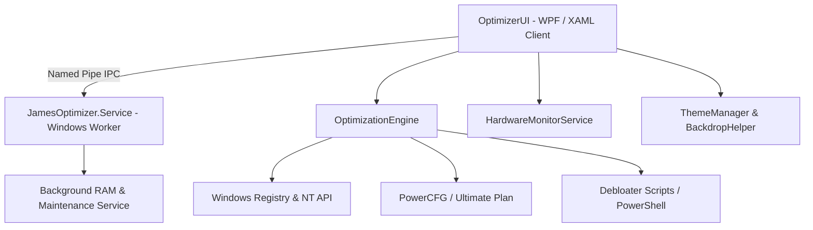

# JamesOptimizer ⚡

[](https://github.com/jamesgod1461/JamesOptimizer)
[](https://github.com/jamesgod1461/JamesOptimizer)
[](https://jamesoptimizer.lovable.app/)
[](https://github.com/jamesgod1461/JamesOptimizer)
[](LICENSE)

> **Last Updated:** October 30, 2026

**JamesOptimizer** is an advanced, high-performance Windows system optimization suite designed to eliminate latency, reclaim system resources, remove bloatware, and unlock maximum gaming and productivity throughput on Windows 10 and Windows 11.

---

## 🌟 Key Features

### 🎮 Gaming Mode & Low Latency Engine
- **Ultimate Performance Power Plan**: Automatically activates and applies the unhidden Windows Ultimate Performance schema (`e9a42b02-d5df-448d-aa00-03f14749eb61`).
- **Low-Latency Registry Tweaks**: Adjusts system responsiveness, MMCSS (Multimedia Class Scheduler Service) network throttling indexes (`NetworkThrottlingIndex`), and CPU scheduling priorities.
- **Standby Memory Purge**: Uses native Windows NT system routines (`NtSetSystemInformation`) to flush the modified list and purge memory standby lists in real time.

### 🌐 Network Boost
- TCP/IP stack tuning (TCP Window Auto-Tuning, ECN Capability, RSS, RSC).
- DNS optimization and ping stabilization.
- Disables bandwidth throttling and background telemetry transmission during active gaming sessions.

### 🧹 System Cleanups & Debloating
- **Integrated Debloater Engine**: Executes tailored Windows 10 and Windows 11 debloater routines for safe removal of telemetry, diagnostic tracking, Cortana, and pre-provisioned bloatware packages.
- **Deep Clean**: Cleans Windows Temp, Prefetch, crash dumps, delivery optimization caches, and browser temporary files.
- **Duplicate & Large File Finder**: Analyzes disk allocations with high-speed scanning and integrated disk utilities.

### 📊 Real-Time Hardware Telemetry
- High-fidelity real-time monitoring of CPU, GPU, RAM, and Disk metrics.
- Temperature, clock speeds, and memory working set inspection.
- Integrated hardware diagnostics hub featuring embedded tools (CPU-Z, GPU-Z, WizTree).

### 🛠️ Service & Startup Management
- Comprehensive inspection of startup apps, background registry run keys, and scheduled tasks.
- Windows Service Manager for tuning non-essential background services with safe fallback profiles.
- Automated background optimization service via `JamesOptimizer.Service` over secure IPC Named Pipes.

---

## 🏗️ Architecture Overview



- **`OptimizerUI`**: Modern desktop user interface styled with fluent dark, light, and G-HUB themes, smooth spring animations, and Mica/Acrylic backdrop blur integration.
- **`JamesOptimizer.Service`**: Lightweight Windows background service communicating via `\\.\pipe\JamesOptimizerPipe` to perform scheduled RAM working set trims and background health maintenance.
- **`OptimizationEngine`**: Central engine orchestrating low-level system calls, privilege adjustments (`TokenAdjustPrivileges`), process execution, and registry modifications.

---

## 🚀 Getting Started

### Prerequisites
- **Operating System**: Windows 10 (Version 2004 or later) / Windows 11 (64-bit)
- **Runtime**: [.NET 8.0 / .NET Framework Desktop Runtime](https://dotnet.microsoft.com/)
- **Permissions**: Administrator privileges required for registry and service configurations

### Installation
1. Clone the repository:
   ```bash
   git clone https://github.com/jamesgod1461/JamesOptimizer.git
   ```
2. Build the solution using Visual Studio 2022 / 2026 or .NET CLI:
   ```bash
   dotnet build optimizer.slnx -c Release
   ```
3. Run the installer script or execute:
   ```bat
   Install.bat
   ```

---

## 🌐 Companion Web App

Explore feature overviews, release notes, and community updates on the official web companion:  
👉 **[https://jamesoptimizer.lovable.app/](https://jamesoptimizer.lovable.app/)**

---

## 📄 License

This project is licensed under the [MIT License](LICENSE).
