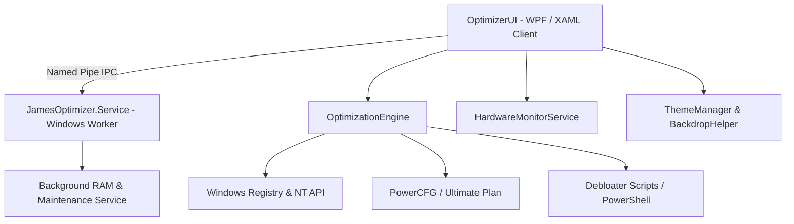

# JamesOptimizer V3 ⚡

[](https://github.com/jamesgod1461/JamesOptimizer)
[](https://github.com/jamesgod1461/JamesOptimizer)
[](https://jamesoptimizer.lovable.app/)
[-brightgreen)](https://github.com/jamesgod1461/JamesOptimizer)
[](LICENSE)

> **Version:** V3 (3.0.0)

**JamesOptimizer V3** is an advanced, high-performance Windows system optimization suite designed to eliminate latency, reclaim system resources, remove bloatware, and unlock maximum gaming and productivity throughput on Windows 10 and Windows 11.

---

## 🌟 Key Features

### 🎮 Gaming Mode & Low Latency Engine
- **Ultimate Performance Power Plan**: Automatically activates and applies the unhidden Windows Ultimate Performance schema (`e9a42b02-d5df-448d-aa00-03f14749eb61`).
- **Low-Latency Registry Tweaks**: Adjusts system responsiveness, MMCSS (Multimedia Class Scheduler Service) network throttling indexes (`NetworkThrottlingIndex`), and CPU scheduling priorities.
- **Standby Memory Purge**: Uses native Windows NT system routines (`NtSetSystemInformation`) to flush the modified list and purge memory standby lists in real time.

### 🌐 Network Boost
- TCP/IP stack tuning (TCP Window Auto-Tuning, ECN Capability, RSS, RSC).
- DNS optimization and ping stabilization.
- Disables bandwidth throttling and background telemetry transmission during active gaming sessions.

### 🧹 System Cleanups & Debloating
- **Integrated Debloater Engine**: Executes tailored Windows 10 and Windows 11 debloater routines for safe removal of telemetry, diagnostic tracking, Cortana, and pre-provisioned bloatware packages.
- **Deep Clean**: Cleans Windows Temp, Prefetch, crash dumps, delivery optimization caches, and browser temporary files.
- **Duplicate & Large File Finder**: Analyzes disk allocations with high-speed scanning and integrated disk utilities.

### 📊 Real-Time Hardware Telemetry
- High-fidelity real-time monitoring of CPU, GPU, RAM, and Disk metrics.
- Temperature, clock speeds, and memory working set inspection.
- Integrated hardware diagnostics hub featuring embedded tools (CPU-Z, GPU-Z, WizTree).

### 🛠️ Service & Startup Management
- Comprehensive inspection of startup apps, background registry run keys, and scheduled tasks.
- Windows Service Manager for tuning non-essential background services with safe fallback profiles.
- Automated background optimization service via `JamesOptimizer.Service` over secure IPC Named Pipes.

---

## 🏗️ Architecture Overview



- **`OptimizerUI`**: Primary WPF desktop client featuring Dark/Light themes, live accent switching, smooth animations, and Mica/Acrylic backdrop blur integration (`\\.\pipe\JamesOptimizerUIPipe`).
- **`JamesOptimizer.WinUI`**: Modern WinUI 3 + Win2D desktop client sharing the core optimization engine (`Core\OptimizationEngine.cs`).
- **`JamesOptimizer.Service`**: Lightweight Windows background service communicating via `\\.\pipe\JamesOptimizerPipe` to perform scheduled RAM working set trims and background health maintenance.
- **`OptimizationEngine`**: Central engine orchestrating low-level system calls, privilege adjustments (`TokenAdjustPrivileges`), process execution, and registry modifications.

---

## 🚀 Getting Started

### Prerequisites
- **Operating System**: Windows 10 (Version 2004 or later) / Windows 11 (64-bit)
- **Runtime**: [.NET 10.0 Desktop Runtime / SDK](https://dotnet.microsoft.com/) (plus Windows App SDK for `JamesOptimizer.WinUI`)
- **Permissions**: Administrator privileges required for registry and service configurations

### Installation
1. Clone the repository:
   ```bash
   git clone https://github.com/jamesgod1461/JamesOptimizer.git
   ```
2. Build the solution using Visual Studio 2022 / 2026 or .NET CLI:
   ```bash
   dotnet build optimizer.slnx -c Release
   ```
3. Run the installer script or execute:
   ```bat
   Install.bat
   ```

---

## 🔒 Privacy & Zero Telemetry

JamesOptimizer sends **zero telemetry** and makes **no background network connections**:
- **ICMP Latency Test**: `1.1.1.1` ping runs only when you explicitly click **Test Latency** in Settings.
- **Winget Package Installer**: Runs `winget.exe` only when you explicitly select and install an optional package in Toolbox.
- **Diagnostics & Crash Logs**: Written locally only (`%LocalAppData%\JamesOptimizer\logs` and `%ProgramData%\JamesOptimizer\logs`) and never uploaded automatically.

---

## 🔧 Tweak Reference & Reversibility

Every tweak records a pre-change snapshot (with key/value tombstones) before modifying the system. Revert any tweak individually from the Audit Drawer, click **PANIC REVERT ALL** in Settings, or run `JamesOptimizer.WinUI.exe --revert-all` from an elevated shell (also executed automatically on uninstall).

| ID | What It Changes | How to Revert |
| --- | --- | --- |
| `power` | Activates Windows Ultimate Performance power plan (`powercfg /setactive`) | Restores previous active power scheme GUID |
| `core_parking` | Sets AC `SUB_PROCESSOR\CPMINCORES` to `100` | Restores previous AC `CPMINCORES` index |
| `system_responsiveness` | `HKLM\...\Multimedia\SystemProfile\SystemResponsiveness=0`, `Win32PrioritySeparation=0x26` | Restores prior DWORD values |
| `network_throttling` | `HKLM\...\Multimedia\SystemProfile\NetworkThrottlingIndex=0xFFFFFFFF` | Restores prior DWORD value |
| `mouse_fix` | `HKCU\Control Panel\Mouse` (`MouseSpeed=0`, `MouseThreshold1=0`, `MouseThreshold2=0`) | Restores prior cursor acceleration strings |
| `keyboard_fix` | `HKCU\Control Panel\Keyboard` (`KeyboardDelay=0`, `KeyboardSpeed=31`) | Restores prior keyboard strings |
| `gpu_pipeline` | `HKLM\SYSTEM\CurrentControlSet\Control\GraphicsDrivers\HwSchMode=2` | Restores/deletes `HwSchMode` (reboot) |
| `mpo_disable` | `HKLM\SOFTWARE\Microsoft\Windows\Dwm\OverlayTestMode=5` | Restores/deletes `OverlayTestMode` (reboot) |
| `game_mode` | `HKCU\Software\Microsoft\GameBar\AutoGameModeEnabled=1` | Restores/deletes DWORD value |
| `windowed_game_opt` | `HKCU\Software\Microsoft\DirectX\UserGpuPreferences\DirectXUserGlobalSettings` | Restores prior string |
| `game_dvr` | `HKCU\System\GameConfigStore\GameDVR_Enabled=0`, `HKLM\...\GameDVR\AllowGameDVR=0` | Restores prior DWORDs |
| `telemetry` | `AllowTelemetry=0`, `MaxTelemetryAllowed=0`, stops/disables `DiagTrack` & `dmwappushservice` | Restores policies and original service start modes |
| `copilot_disable` | `TurnOffWindowsCopilot=1` (HKCU/HKLM), Edge `HubsSidebarEnabled=0` | Restores/deletes policy keys |
| `recall_disable` | `WindowsAI\DisableAIDataAnalysis=1` (HKCU/HKLM) | Restores/deletes policy keys |
| `office_telemetry` | Office 16.0 `osm\Enablelogging=0`, `EnableUpload=0`, `common\qmenable=0` | Restores/deletes HKCU values |
| `cortana` | `AllowCortana=0`, `DisableWebSearch=1`, `ConnectedSearchUseWeb=0`, `DisableSearchBoxSuggestions=1` | Restores/deletes search policy values |
| `taskbar_clutter` | `AllowNewsAndInterests=0`, `TaskbarDa=0`, `TaskbarMn=0`, `ShowSyncProviderNotifications=0`, `ContentDeliveryManager` promos `=0` | Restores prior Explorer/shell values |
| `privacy_advertising` | `AdvertisingInfo\Enabled=0`, `TailoredExperiencesWithDiagnosticDataEnabled=0`, `EnableActivityFeed=0`, `PublishUserActivities=0` | Restores prior privacy values |
| `privacy_clipboard` | `AllowCrossDeviceClipboard=0`, `AllowClipboardHistory=0` | Restores/deletes clipboard policies |
| `onedrive_disable` | `HKLM\...\OneDrive\DisableFileSyncNGSC=1` | Restores/deletes policy value |
| `visuals` | `VisualFXSetting=2`, `EnableTransparency=0`, `MenuShowDelay=0`, `MinAnimate=0` | Restores prior visual effect settings |
| `indexing` | Stops and disables `WSearch` service | Restores `WSearch` start mode and running state |
| `utc_clock` | `TimeZoneInformation\RealTimeIsUniversal=1` | Restores/deletes DWORD (reboot) |
| `modern_standby` | `Control\Power\PlatformAoAcOverride=0` (S3-capable laptops only) | Restores/deletes DWORD (reboot) |
| `elite_bcd_timers` | `bcdedit /set disabledynamictick yes` & `tscsyncpolicy Enhanced` | Restores or deletes BCD entries (reboot) |
| `elite_fsutil` | `NtfsDisable8dot3NameCreation=1`, `NtfsDisableLastAccessUpdate=0x80000001` | Restores prior FileSystem DWORDs (reboot) |
| `elite_mem_compression` | `Memory Management\DisablePageCombining=1` | Restores/deletes DWORD |
| `net_tcp_low_latency` | `Psched\NonBestEffortLimit=0` + `TcpAckFrequency=1`, `TCPNoDelay=1` on active NICs | Restores prior Psched & interface values |
| `gpu_amd_ulps` | `Class\{4d36e968...}\0000\EnableUlps=0` (AMD GPU only) | Restores prior `EnableUlps` (reboot) |
| `gpu_nvidia_power` | `nvlddmkm\Global\NVTweak\DisplayPowerSaving=0` (NVIDIA GPU only) | Restores prior `DisplayPowerSaving` |

---

## 🌐 Companion Web App

Explore feature overviews, release notes, and community updates on the official web companion:  
👉 **[https://jamesoptimizer.lovable.app/](https://jamesoptimizer.lovable.app/)**

---

## 📄 License

This project is licensed under the [MIT License](LICENSE).
